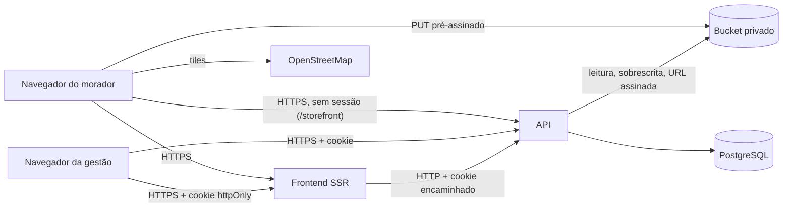

# Segurança

**Curupira** · como avisar de uma falha, o que se protege, de quem, e como

> O modelo de ameaças (§2) é ancorado em evidência: cada fronteira, superfície e abuso aponta um
> caminho do repositório. Revisado quando muda fronteira: rota pública nova, integração, upload,
> papel novo (`_standards/documentation.md` §5). Segredo encontrado no caminho é redigido aqui,
> nunca copiado.

## 1. Como reportar uma vulnerabilidade

Não abra issue pública. Escreva para o dono do repositório, Jhollyfer Rodrigues
(`jhollyfer.fr@gmail.com`), com passos para reproduzir. Contato de segurança dedicado e prazo de
resposta ainda não foram definidos (`PRD.md` §8).

## 2. Modelo de ameaças

### 2.1 Escopo e premissas

- Dentro: API (`backend/`), app do morador e painel (`frontend/`), contrato (`shared/`), bucket de fotos,
  pipeline do GitHub Actions e deploy no Coolify.
- Fora: a conta do Coolify, do Docker Hub e do provedor do bucket (só se pede MFA e token de menor
  escopo); o banco gerenciado; o proxy Traefik além do que `ENV.md` exige dele.
- Premissas: TLS terminado no Traefik; banco sem acesso público; o bucket é privado e nenhum objeto sai
  por URL pública; produção separada de CI e de desenvolvimento.

### 2.2 Componentes, fluxos e fronteiras de confiança

| Fronteira | Entre | O que a protege | Evidência |
|---|---|---|---|
| internet para rota pública da API | morador e `/storefront` | throttle por IP em toda escrita e na consulta de protocolo; consulta pública seleciona só colunas públicas; validator Zod/VineJS | `backend/start/limiter.ts`, `backend/start/routes.ts`, `backend/app/repositories/report/report.lucid.repository.ts` |
| internet para rota autenticada | gestão e a API | cookie `httpOnly`, `Origin` contra a lista do `SITE_URL`, `auth()` e `role()` no grupo, throttle por conta e por IP no login | `backend/app/middleware/origin.middleware.ts`, `role.middleware.ts`, `backend/config/cookie.ts` |
| navegador para bucket | foto da denúncia | URL `PUT` pré-assinada de 15 min com tamanho fixado; `complete` confere tamanho e assinatura e reencoda | `backend/app/features/storefront/report-photos/`, `backend/app/services/multipart/multipart.service.ts` |
| API para bucket | leitura e escrita | credencial `STORAGE_KEY` do usuário `app-rw`; bucket privado; leitura da gestão por URL assinada de 15 min | `backend/infra/minio/minio-setup.sh`, `backend/config/drive.ts` |
| navegador para CDN de tiles | mapa | CSP libera só `https://tile.openstreetmap.org` em `img-src` | `frontend/vite.config.ts` |
| CI para produção | GitHub e Coolify | `COOLIFY_TOKEN` em secret, uuid conferido, smoke test por revisão | `.github/workflows/main-deploy-coolify.yml` |

### 2.3 Ativos

| Ativo | Por quê importa | C / I / D | Onde fica | Quem acessa |
|---|---|---|---|---|
| Anonimato de quem denuncia | medo de retaliação derruba a denúncia; é a promessa central do produto | C | ausência de dado: sem `contact`, nada sobre o autor; contador do limiter com o IP, temporário | ninguém |
| Contato opcional (telefone ou e-mail) | dado pessoal (LGPD) | C | `reports.contact`, texto de até 120 caracteres | só a gestão, no detalhe da ocorrência |
| Foto e ponto no mapa | revelam o lugar, e a foto crua revela o aparelho e a posição | C | bucket privado e `reports.latitude/longitude` | gestão (foto por URL assinada); o público vê o ponto, o tipo e o dia, sem foto |
| Protocolo | única chave da página de acompanhamento | C | `reports.protocol` | quem o recebeu; a gestão |
| Senha da gestão | tomada de conta | C | hash no banco (`users.password`) | ninguém lê |
| Sessão (access e refresh) | acesso ao painel | C, I | cookies `httpOnly` e tabela `auth_access_tokens` | o navegador da pessoa |
| Situação e resposta de cada denúncia | confiança pública no canal | I | `report_status_events` | gestão grava; o morador lê |
| Cronograma e avisos | informação pública que precisa ser correta | I, D | `collection_schedules`, `notices` | `ADMINISTRATOR` (cronograma), os dois papéis (avisos) |
| Disponibilidade do envio | o morador denuncia onde há pouco sinal | D | PWA, fila local, API | |

### 2.4 Atacante

| Pode | Não pode (premissa) |
|---|---|
| chamar qualquer rota de `/storefront` sem conta, de muitos IPs | ler o banco ou o bucket diretamente |
| enviar corpo, `Content-Type`, tamanho e foto arbitrários, e arquivo que não é imagem | quebrar TLS entre navegador e Traefik |
| tentar adivinhar protocolos e senhas | obter `COOLIFY_TOKEN`, `APP_KEY` ou as credenciais do bucket |
| forjar `Origin`, `X-Forwarded-For` e cabeçalhos pelo `curl` | forjar o `Origin` de outro site dentro de um navegador de vítima |
| operador tentando abrir área de administrador | alterar o código ou o pipeline sem passar por PR do dono |
| conta de gestão roubada | |

### 2.5 Superfícies

| Superfície | Como chega | Fronteira | Evidência |
|---|---|---|---|
| Criar denúncia | `POST /storefront/reports` | internet para API | `backend/app/features/storefront/reports/create/` |
| Upload de foto | `POST /storefront/report-photos`, `PUT` no bucket, `POST .../complete` | internet, bucket | `backend/app/features/storefront/report-photos/` |
| Consulta por protocolo | `GET /storefront/reports/:protocol` | internet para API | `backend/app/features/storefront/reports/show-by-protocol/` |
| Mapa público | `GET /storefront/reports/map` | internet para API | `backend/app/features/storefront/reports/map/` |
| Entrada no painel | `POST /authentication/sign-in` | internet para API | `backend/app/features/authentication/sessions/sign-in/` |
| Painel | `/management/*`, `/account`, `/storages` | internet para API autenticada | `backend/start/routes.ts` |
| Renovação de sessão | `POST /authentication/refresh` | internet para API | `backend/app/features/authentication/sessions/refresh/` |
| Documentação da API | `/openapi.json`, `/documentation` | internet para API | `backend/app/middleware/documentation.middleware.ts` |
| Fila offline no aparelho | IndexedDB e `localStorage` | aparelho do morador | `frontend/src/lib/report-queue.ts` |
| Cabeçalhos do app | Nitro, só no build de produção | internet para frontend | `frontend/vite.config.ts` |

### 2.6 Abusos priorizados

| Id | Abuso | Probabilidade | Impacto | Prioridade | Mitigação | Evidência |
|---|---|---|---|---|---|---|
| TM-001 | encher o banco e a fila da gestão com denúncias falsas | alta | médio | alta | 10 envios por hora por IP, bloqueio de 10 min ao estourar; foto exigida (1 a 3); mapa público só mostra o que a equipe já abriu | `backend/start/limiter.ts` (`reportCreateThrottle`), `backend/app/domain/report/report.entity.ts` |
| TM-002 | encher o bucket com arquivos anônimos | alta | médio | alta | 60 chamadas por hora por IP nas rotas de foto; teto `REPORT_PHOTO_MAX_SIZE` no validator e no `Content-Length` assinado; só `jpeg`, `png`, `webp`; `PENDING` abandonado sai no `storages:prune` | `backend/start/limiter.ts` (`reportPhotoThrottle`), `backend/app/validators/storefront/report-photos.validator.ts`, `backend/commands/storages-prune.command.ts` |
| TM-003 | subir arquivo que não é imagem com `Content-Type` de imagem (HTML, script, bomba de descompressão) | média | alto | alta | `complete` confere os primeiros bytes contra a assinatura do tipo; `sharp` decodifica com limite de 60 milhões de pixels e `failOn: error`; o objeto é reescrito pela saída do `sharp`; falha apaga objeto e linha | `backend/app/domain/storage/storage.entity.ts`, `backend/app/services/photo-sanitizer/photo-sanitizer.service.ts` |
| TM-004 | revelar posição ou aparelho pelo EXIF da foto | alta | alto | alta | o navegador redesenha a foto no canvas; o servidor reencoda sem `withMetadata`; a coordenada vem do pin confirmado, nunca do EXIF | `frontend/src/lib/image.ts`, `backend/app/services/photo-sanitizer/photo-sanitizer.service.ts` |
| TM-005 | enumerar protocolos para ler o andamento de denúncias alheias | média | médio | média | protocolo de 8 símbolos de um alfabeto de 32 (2^40) sorteado com `crypto.randomInt`; 30 consultas por 10 min por IP com bloqueio de 10 min; a resposta traz só tipo, situação, datas e mensagens da gestão (sem contato, descrição, foto nem ponto); protocolo mal formado responde 404 igual ao inexistente | `backend/app/services/protocol/protocol.service.ts`, `backend/start/limiter.ts` (`reportLookupThrottle`) |
| TM-006 | descobrir quem denunciou pelo mapa público ou pela consulta | média | alto | alta | o mapa devolve id, tipo, situação, ponto e o dia (nunca a hora), sem contato, descrição nem foto; a consulta seleciona colunas explícitas | `backend/app/repositories/report/report.lucid.repository.ts` (`publicMap`, `showByProtocol`) |
| TM-007 | ler o contato de quem denunciou | baixa | alto | alta | `contact` só aparece em `ManagementReportShowResponse`, atrás de `auth()` e `role()`; o teste de vazamento de resposta confere os campos | `backend/app/core/response-leak.e2e.spec.ts`, `shared/src/responses/management/reports.response.ts` |
| TM-008 | força bruta ou preenchimento de credencial no login | alta | alto | alta | 5 tentativas por minuto por IP com bloqueio de 10 min, e 20 por hora por e-mail normalizado; mensagem única; hash gasto mesmo para conta inexistente | `backend/start/limiter.ts`, `backend/app/features/authentication/sessions/sign-in/sign-in.use-case.ts` |
| TM-009 | CSRF de outro site contra a sessão da gestão | média | alto | alta | `Origin` (ou `Sec-Fetch-Site`) conferido em todo método não seguro, antes do bodyparser; CORS com origem explícita e `credentials`; cookie `sameSite=lax` | `backend/app/middleware/origin.middleware.ts`, `backend/config/cors.ts` |
| TM-010 | operador executar ação de administrador, ou abrir rota nova sem proteção | média | alto | alta | `role()` por grupo; `authz-check` falha quando a cadeia de qualquer rota muda; o front esconde o link, mas o 403 é do backend | `backend/start/routes.ts`, `backend/scripts/authz-check.ts` |
| TM-011 | baixar arquivo da biblioteca sem sessão | baixa | médio | média | bucket privado; download exige `auth()` e `StoragePolicy` | `backend/app/policies/storage.policy.ts` |
| TM-012 | todos os moradores caírem no mesmo balde de throttle (IP do proxy) ou o IP ser forjável | média | alto | alta | `TRUSTED_PROXIES` obrigatório, `loopback,uniquelocal` em produção, nunca `true` | `backend/start/env.ts`, `backend/config/app.ts` |
| TM-013 | embutir o site em outro por `iframe` (clickjacking) | baixa | médio | baixa | `frame-ancestors 'none'` no app e `X-Frame-Options: DENY` na API | `frontend/vite.config.ts`, `backend/config/shield.ts` |
| TM-014 | vazar segredo por log | baixa | alto | média | redação de `password`, tokens, `authorization` e `cookie`; o corpo da denúncia não é logado | `backend/config/logger.ts`, `backend/app/core/log-redaction.unit.spec.ts` |
| TM-015 | commit com autoria de agente ou segredo no repositório, ou workflow injetável | baixa | médio | média | Gitleaks, `pnpm audit --prod`, varredura de `pull_request_target` e de `github.event` em `run:`, checagem de autor e trailers | `.github/workflows/ci.yml`, `.github/workflows/main-check-backend.yml` |

### 2.7 Calibragem de criticidade

- Crítico: identificar quem denunciou; sessão de gestão tomada; execução de código por arquivo enviado.
- Alto: ler contato ou foto sem papel; escalada de operador para administrador; deploy no projeto errado.
- Médio: enxurrada de denúncias falsas que atrasa a fila; enumeração de protocolo com sucesso raro.
- Baixo: enumeração de dados públicos (bairros, cronograma, avisos); falha de cabeçalho sem exploração.

### 2.8 Para revisão manual

- Todo `select` novo em `ReportRepository` que alcance uma rota `/storefront`: conferir que nenhuma
  coluna além das públicas sai.
- Mudança em `start/limiter.ts`, `origin.middleware.ts`, `photo-sanitizer.service.ts` ou na assinatura de
  `storage.entity.ts`.
- Log de acesso do Traefik no Coolify: se ele grava o IP do morador junto com a rota `POST /storefront/reports`,
  a promessa "o servidor não guarda nada sobre quem enviou" fica mais fraca. Fora do repositório; a conferir.
- `VITE_STORAGE_URL`: sem ela a CSP de produção bloqueia o `PUT` da foto; com valor largo demais, abre
  `connect-src`.
- Intervalo de coordenadas aceito: o validator limita a latitude e longitude do mundo, e o frontend prende o
  pin à caixa do município; a API não impõe a caixa.

## 3. Autenticação e sessão

- Cookies `access-token` (1 dia) e `refresh-token` (7 dias): `httpOnly`, `sameSite=lax`, `secure` em
  produção, `Domain` pelo `COOKIE_DOMAIN`. O nome do token é conferido pelo guard para recusar um
  refresh usado como access (`backend/config/cookie.ts`, `backend/app/guards/cookie-access-tokens.guard.ts`).
- `sign-out` revoga os tokens da sessão; mudar papel ou situação de uma conta revoga todas as sessões dela.
- Limite de tentativas: `signIn` 5 por minuto por IP (bloqueio de 10 min), `signInAccount` 20 por hora por
  e-mail (bloqueio de 10 min), `refresh` 30 por minuto por IP, `accountUpdate` 10 por hora por usuário
  (bloqueio de 10 min).
- A resposta de credencial errada é a mesma para e-mail inexistente, senha errada e conta inativa.
- Não há recuperação de senha nem autocadastro: o administrador cria as contas. A troca de senha exige a
  senha atual (`PUT /account`).

## 4. Autorização

- Toda rota da gestão passa por `auth()` e `role()` no grupo; o escopo vem da sessão (`actor`), nunca de id
  vindo do cliente. Registro inexistente e registro negado respondem igual quando há política de posse.
- A matriz abaixo é a que o código impõe (`backend/start/routes.ts`) e a que a interface espelha
  (`frontend/src/lib/capabilities.ts`).

| Capacidade | `OPERATOR` | `ADMINISTRATOR` |
|---|---|---|
| Ver visão geral, estatísticas e mapa da gestão | sim | sim |
| Listar, abrir e excluir ocorrências; ler foto e contato | sim | sim |
| Mudar situação (só avança) e registrar resposta | sim | sim |
| Criar, editar, encerrar e excluir avisos | sim | sim |
| Ver e editar o próprio perfil e trocar a senha | sim | sim |
| Biblioteca de arquivos (`/storages`) | sim | sim |
| Criar, editar e excluir cronograma | não (403) | sim |
| Criar, editar e excluir bairros | não (403) | sim |
| Criar, editar e excluir contas | não (403) | sim |
| Mudar o próprio papel ou situação; excluir a própria conta | não | não (`UserPolicy`) |

## 5. Entrada e saída

- Todo dado de fora passa por validator antes da regra: VineJS no backend (`backend/app/validators/`),
  Zod em `shared/` para o frontend. Tetos: descrição 1000 caracteres, contato 3 a 120, resposta da gestão
  500, aviso 120 e 600, 1 a 3 fotos.
- Upload da denúncia: só `image/jpeg`, `image/png` e `image/webp`; tamanho de 1 byte até
  `REPORT_PHOTO_MAX_SIZE`, fixado na URL assinada; assinatura conferida; reencodado sem metadado.
- Upload da biblioteca: tipos de `STORAGE_MIMETYPES` (imagens, PDF e áudio) com a mesma conferência de
  assinatura, teto `UPLOAD_MAX_SIZE`, multipart pré-assinado.
- Mensagem de validação sempre localizada; resposta de erro não vaza stack, SQL nem caminho
  (`backend/app/exceptions/handler.ts`).
- Cabeçalhos: a API envia `X-Frame-Options: DENY`, HSTS (180 dias) e `nosniff`; a CSP do Adonis fica
  desligada porque a API não serve HTML. O app envia, só no build de produção, `Content-Security-Policy`
  (`default-src 'self'`, `script-src` e `style-src` com `'unsafe-inline'` porque o Start escreve scripts
  de hidratação sem nonce, `img-src` e `connect-src` com a API e o bucket, `img-src` também com
  `https://tile.openstreetmap.org`, `frame-ancestors 'none'`, `object-src 'none'`), `X-Content-Type-Options`,
  `Referrer-Policy: strict-origin-when-cross-origin` e HSTS de um ano sem `preload`.
- O `shield` com CSRF por token está desligado de propósito: a barreira é o `Origin`.

## 6. Segredos

- Só em variável de ambiente (`ENV.md`); nada de segredo no código, log ou `docs/`.
- Rotação: `APP_KEY` (invalida sessões e dados cifrados), `STORAGE_SECRET`, `COOLIFY_TOKEN` e
  `DOCKERHUB_TOKEN` pelo painel de cada provedor; quem rotaciona é o dono, a cada troca de pessoa com acesso
  ou suspeita de vazamento. Prazo regular de rotação: a definir.
- A senha do dono nasce de `SEED_OWNER_PASSWORD`, sem default; o seeder para sem ela.

## 7. Dependências

- Última versão publicada (`_standards/tooling.md` §0); Dependabot semanal para npm, Actions e imagens base
  fixadas por digest.
- `pnpm audit --prod --audit-level=high` e Gitleaks em todo PR (`.github/workflows/ci.yml`).
- Bibliotecas sem entrada na `_doc-lib/` (Leaflet, react-leaflet, `vite-plugin-pwa`, `sharp`) usam a página
  oficial de cada uma; a proposta de entrada está em `MEMORY.md`.

## 8. Dados pessoais (LGPD)

| Dado | Finalidade | Base legal | Retenção | Exclusão |
|---|---|---|---|---|
| Contato opcional da denúncia | a gestão dar retorno a quem pediu | consentimento (o morador escolhe "Deixar contato") | enquanto a denúncia existir; prazo da prefeitura a definir | excluir a ocorrência no painel (`DELETE /management/reports/:id`) apaga o contato; não há rotina automática |
| Foto e ponto da denúncia | a equipe localizar e tratar o problema | execução de política pública (o dado não identifica a pessoa; o EXIF é removido) | enquanto a denúncia existir; prazo a definir | exclusão da ocorrência; o arquivo no bucket é removido junto com o registro `Storage` |
| IP do morador | limitar abuso | legítimo interesse (segurança) | só na tabela `rate_limits`, até a janela do limite expirar (1 hora ou 10 minutos, mais o bloqueio de 10 minutos), com limpeza automática | expira sozinho |
| Nome, e-mail e senha (hash) da gestão | operar o painel | execução das funções do cargo | enquanto a conta existir | `DELETE /management/users/:id` (a conta não exclui a si mesma) |
| Protocolos, bairro e fila de denúncias no aparelho | o morador acompanhar e reenviar | consentimento implícito do uso, sem envio ao servidor | até o morador limpar os dados do site | limpar os dados do site no navegador |

Os textos de `/privacidade` e `/termos` (`frontend/messages/*.json`) são rascunho: a prefeitura e a
procuradoria revisam antes da abertura. O direito de acesso, correção e exclusão é atendido pela
prefeitura de Benjamin Constant; a denúncia anônima não pode ser localizada por quem a fez, a não ser
pelo protocolo.

### 8.1 Riscos aceitos e abertos

| Risco | Situação |
|---|---|
| Sem retenção automática de denúncias, fotos e contatos | aceito para o MVP; a prefeitura define o prazo e a rotina de eliminação |
| O mapa público mostra o ponto exato e o dia | decisão do produto (`DECISIONS.md` #9); o pin já é do lugar do problema, não da pessoa, mas morador que denuncia a própria rua pode ser inferido |
| Throttle por IP: moradores atrás do mesmo NAT dividem o limite | aceito; o limite de 10 envios por hora é folgado para uso real |
| IP no log do proxy | a verificar fora do repositório (§2.8) |
| Sem varredura de vírus em arquivos da biblioteca da gestão | aceito: só a gestão autenticada envia, e a assinatura é conferida |
| CSP do app com `'unsafe-inline'` | exigência do TanStack Start sem nonce |
| Sem auditoria de segurança do diff inteiro | pendente (`TASKS.md` 5.2) |
| `VITE_STORAGE_URL` fora da CSP em produção | pendente: a foto não sobe até ser definida |

## 9. Checklist de revisão

- [ ] Rota nova tem auth e policy; rota pública nova, integração, upload ou papel atualizou o §2.
- [ ] Rota pública nova tem throttle por IP e seleciona só colunas públicas.
- [ ] Nenhum segredo no diff.
- [ ] Entrada validada; saída sem contato, descrição ou foto em rota pública.
- [ ] Log sem senha, token, contato ou outro dado pessoal.
- [ ] `authz:check` e `openapi:check` regravados no mesmo commit quando a cadeia de uma rota mudou.
